  
  

### About me

Systems Engineer from Costa Rica with **5+ years** building enterprise software with **.NET and Python**, integrated with Oracle, SQL Server, SAP and REST APIs.

- 🔧 Now: **Python Developer / Automation Engineer**: Python services, process automation, **Zabbix** monitoring and service testing.
- 🏛️ Before: full stack .NET for public and private sector clients (Blazor, ASP.NET, Entity Framework, Oracle, SAP).
- 📱 On the side: Android apps in Kotlin, React Native, local-first web apps and AI-assisted development tooling.
- 🌎 Spanish (native) · English (intermediate)

### Tech stack

**Backend & automation** 

**Data & integration** 

**Frontend & mobile** 

**AI** 

### Featured projects

| Project | What it does | Stack | Status |
|---|---|---|---|
| [**Espejo**](https://aluiscard-develop.github.io/espejo-app/) | Personal style advisor that runs 100 % in the browser: the photo never leaves the device | JavaScript · MediaPipe · PWA | 🟢 [Live](https://aluiscard-develop.github.io/espejo-app/) |
| **KitFlow** | Mobile app to track scale-model kits from wishlist to collection; ES / EN / JA | React Native · Expo · SQLite | 🟡 Google Play closed testing |
| **GYMpro** | Android gym app with rest timer, routines, nutrition and an AI coach | Kotlin · Compose · Room · Claude API | 🟢 v1.0.0 signed |
| **Mis-Finanzas** | Personal finance in colones and dollars, on-device receipt OCR, encrypted DB | Kotlin · Hilt · SQLCipher · ML Kit | 🔵 In development |
| **WingsDevs** | Autonomous dev harness: an AI agent implements user stories in checkpoints you approve | Python · Docker · SQLite | 🟢 Working MVP |
| **Loop_compuertas** | Ports code between languages and proves equivalence by execution (differential testing) | Python · TypeScript · Kotlin | 🔵 In development |

Most of these repositories are private. Walkthrough or repo access on request.

### Certifications

- **Ultimate AI**: AI-assisted software development (2026)
- **Dante Level 1 Certified**, Audinate (2025, valid until 2028)
- **Advanced Zabbix Security Administration**, Zabbix (2025)
- **Advanced Zabbix SNMP Monitoring**, Zabbix (2025)

### Contributions

<picture>
  <source media="(prefers-color-scheme: dark)" srcset="https://raw.githubusercontent.com/Aluiscard-develop/Aluiscard-develop/output/snake-dark.svg">
  
</picture>

<b>🇨🇷 En español</b>

Ingeniero en Sistemas de Costa Rica con **más de 5 años** desarrollando software empresarial con **.NET y Python**, integrado con Oracle, SQL Server, SAP y APIs REST.

- Hoy: **Python Developer / Automation Engineer**: servicios en Python, automatización de procesos, monitoreo con **Zabbix** y pruebas de servicios.
- Antes: full stack .NET para el sector público y privado (Blazor, ASP.NET, Entity Framework, Oracle, SAP).
- En paralelo: apps Android en Kotlin, React Native, web local-first y herramientas de desarrollo asistido por IA.

Portafolio completo, en español e inglés: **[aluiscard-develop.github.io](https://aluiscard-develop.github.io/)**

